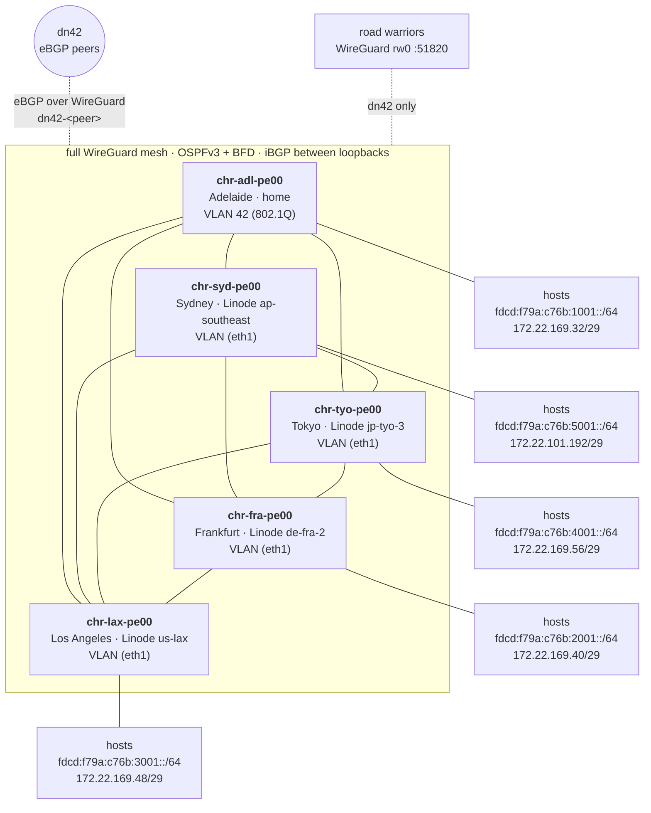

# Network diagram

Five PoPs, one ASN (AS4242423420). Four of them are Linode servers, one is at home. Every PoP
is named `chr-<loc>-pe00.dc.chrissss.dn42` (`pe` = provider edge) and has a VLAN behind it.

## Per PoP

| Name | Where | Platform | `router_id` | IPv4 `/29` | Router `+1` | Loopback `+2` | RW `/32` `+3` | IPv6 `/52` | Hosts `/64` |
|---|---|---|---|---|---|---|---|---|---|
| `chr-adl-pe00` | Adelaide, AU | home server | 1 | `172.22.169.32/29` | `.33` | `.34` | `.35` | `fdcd:f79a:c76b:1000::/52` | `…:1001::/64` |
| `chr-fra-pe00` | Frankfurt, DE | Linode `de-fra-2` | 2 | `172.22.169.40/29` | `.41` | `.42` | `.43` | `…:2000::/52` | `…:2001::/64` |
| `chr-lax-pe00` | Los Angeles, US | Linode `us-lax` | 3 | `172.22.169.48/29` | `.49` | `.50` | `.51` | `…:3000::/52` | `…:3001::/64` |
| `chr-tyo-pe00` | Tokyo, JP | Linode `jp-tyo-3` | 4 | `172.22.169.56/29` | `.57` | `.58` | `.59` | `…:4000::/52` | `…:4001::/64` |
| `chr-syd-pe00` | Sydney, AU | Linode `ap-southeast` | 5 | `172.22.101.192/29` | `.193` | `.194` | `.195` | `…:5000::/52` | `…:5001::/64` |

IPv4 hosts behind a router use the `/29`'s `+4..+6`. The IPv6 `…` is `fdcd:f79a:c76b`; the
loopbacks `fdcd:f79a:c76b::<router_id>` ride in OSPFv3. Road warriors get the `…:<N>f00::/64`
(IPv6) and the PoP's `+3` `/32` (IPv4, one device per PoP).

## What each VLAN is

| | Cloud PoPs (Linode) | Home (`chr-adl-pe00`) |
|---|---|---|
| Kind | Linode VLAN: a private Layer 2 network, attached to the server as `eth1` when it is created | an 802.1Q tagged VLAN on the LAN NIC (`vlan_id`, `vlan_parent` in `host_vars`) |
| Created by | `provision.yml` (label = the router's name) | your switch/router: make the port a trunk that carries the VLAN |
| Router side | `vpc` role: static `<N>001::1/64` and `+1` of the `/29`, no DHCP | the same, on the tagged sub-interface (`ens18.42`) |

## Where things live

| Thing | Where |
|---|---|
| Names | inventory hostname = `chr-<loc>-pe<nn>`; FQDN = name + `dn42_domain` (`dc.chrissss.dn42`) |
| Addresses | `pop_block4` per PoP in `inventory/host_vars/<name>.yml` |
| Mesh and iBGP | derived from the inventory; nothing to configure |
| External dn42 peers | `ebgp_peers` in the host_vars of the PoP that terminates them |
| Road-warrior devices | `rw_clients` in `inventory/group_vars/dn42_routers/main.yml` |

The `dc.chrissss.dn42` zone itself (A/AAAA/PTR records for these names) is yours to publish;
the playbooks only set each router's hostname.
